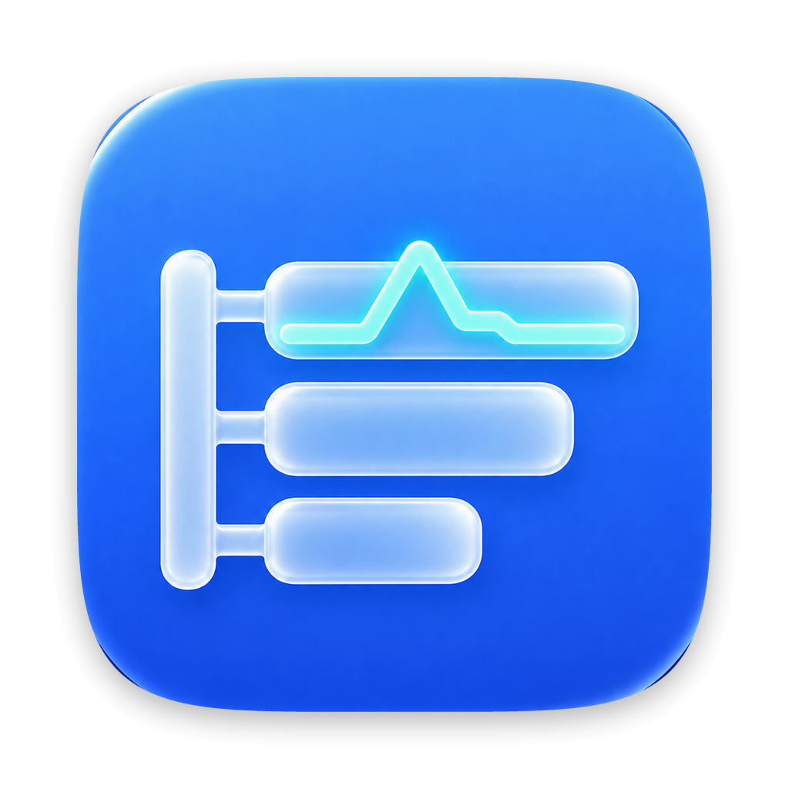
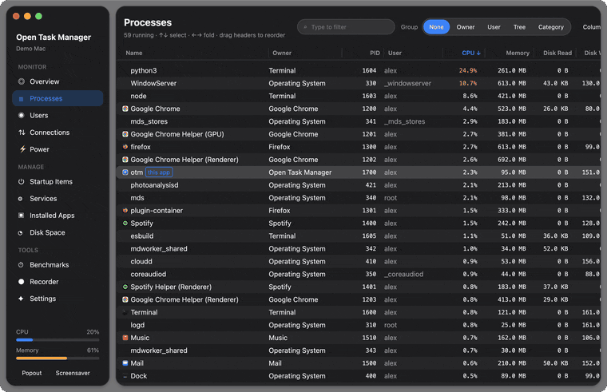
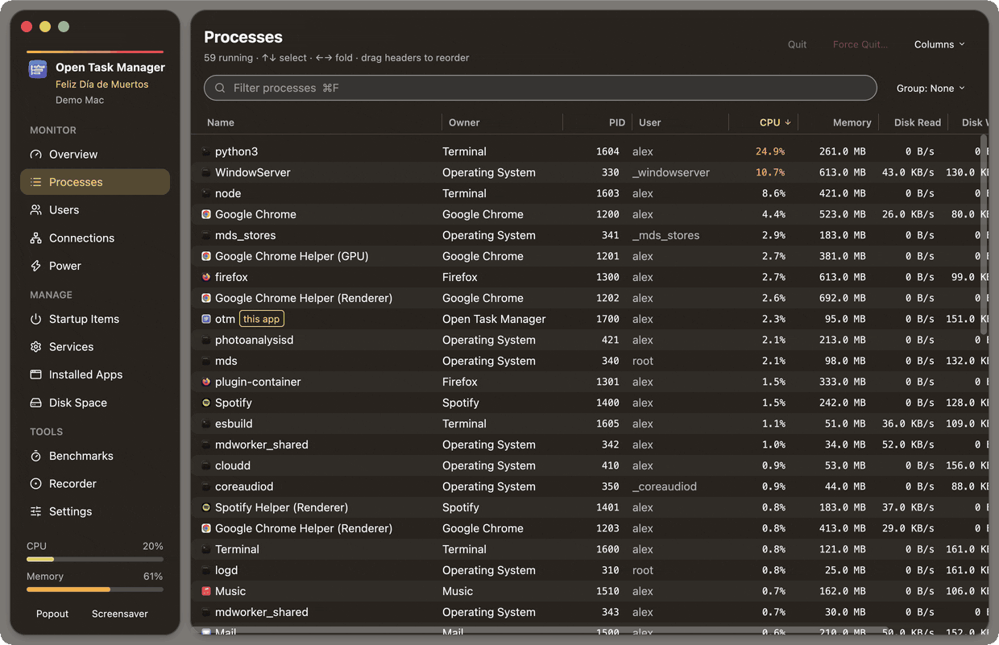
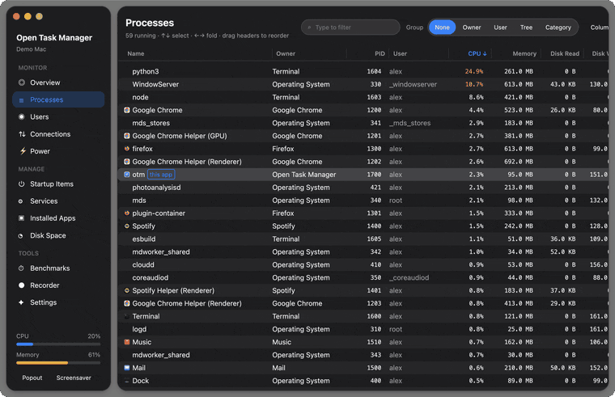
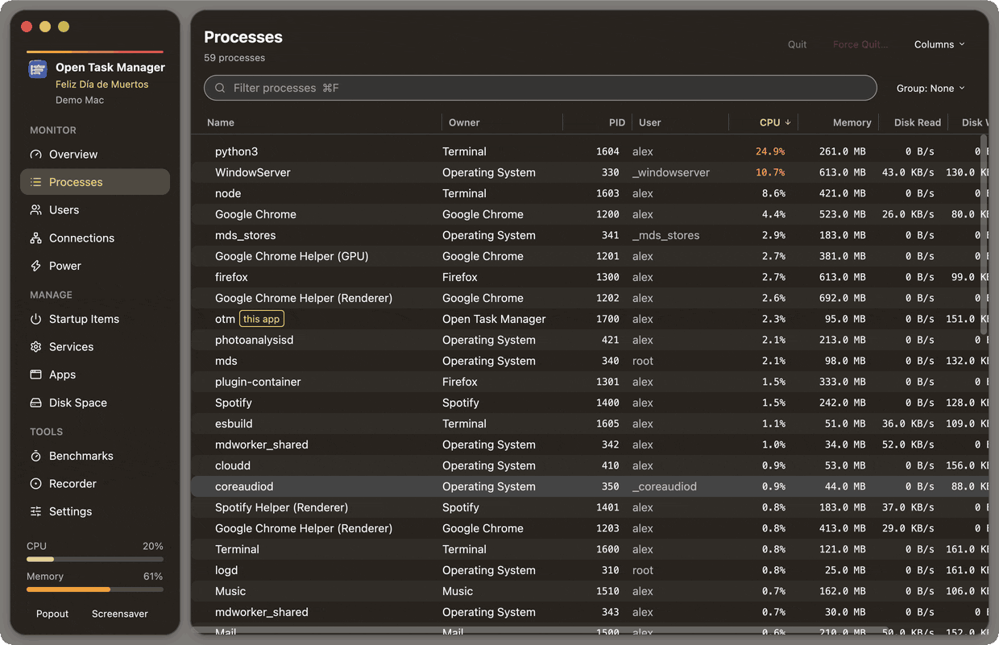
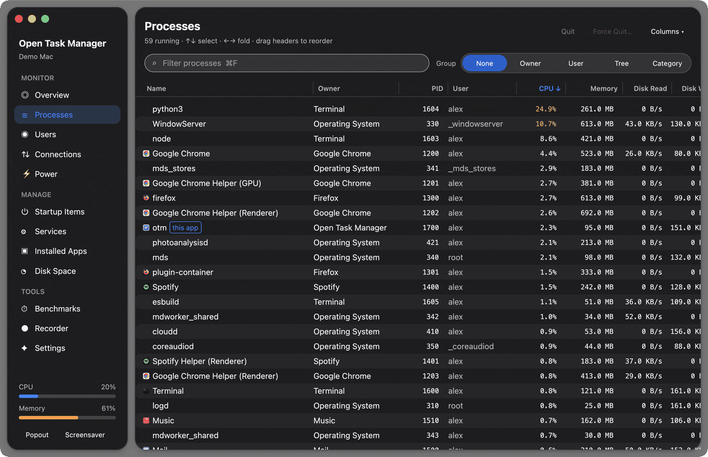
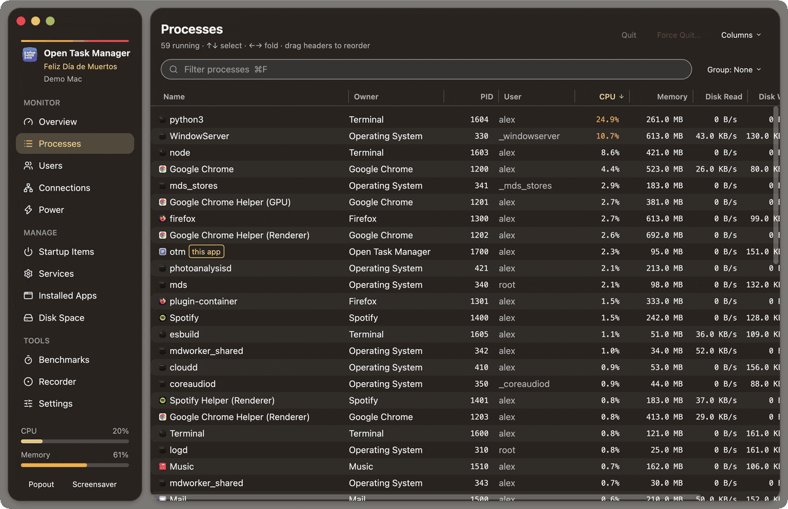
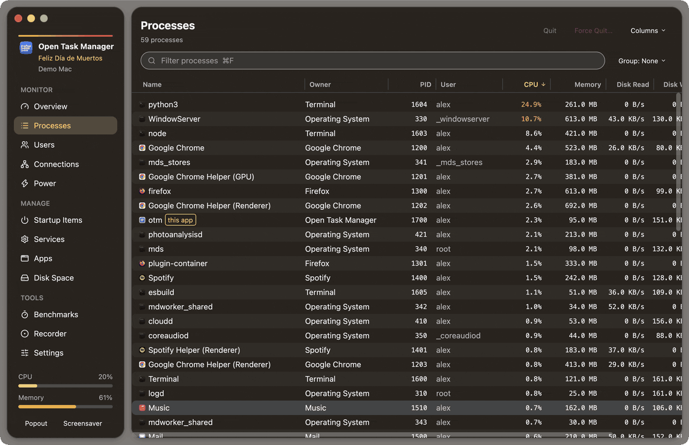
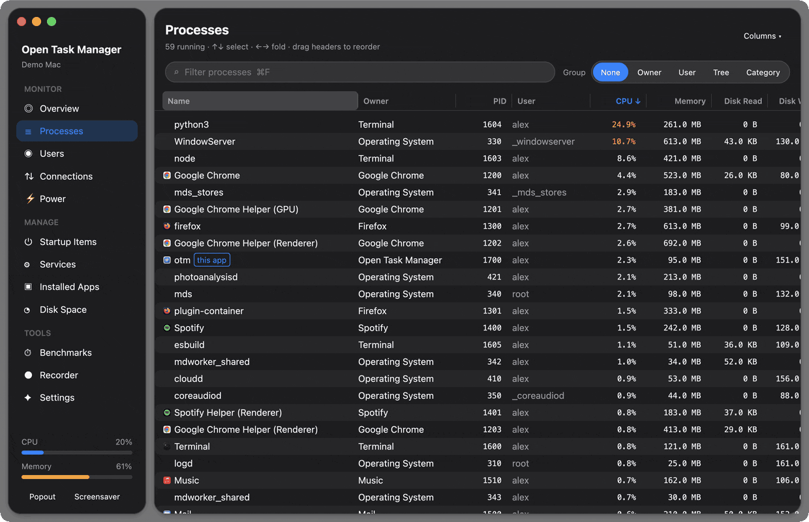

<p align="center">
  
</p>

<h1 align="center">Open Task Manager</h1>

<p align="center">
  A fast, native, open-source system monitor for macOS, written in Rust with <a href="https://gpui.rs">GPUI</a>.<br>
  Everything runs locally. Nothing is sent anywhere.
</p>

<p align="center">
  <a href="https://github.com/elad12390/open-task-manager/actions/workflows/ci.yml"></a>
  <a href="LICENSE"></a>
  
  <a href="https://elad12390.github.io/open-task-manager/"></a>
</p>

<p align="center">
  
</p>

<sub>All recordings use the app's demo mode, which shows a fictional Mac.</sub>

---

## Install

### One line (macOS and Linux)

```sh
curl -fsSL https://elad12390.github.io/open-task-manager/install.sh | sh
```

It picks the build for your computer and checks its SHA-256 before installing: the Homebrew cask (or the DMG
into Applications) on macOS; the Flatpak on Linux when `flatpak` is installed, else the `.deb` through `apt`.
`OTM_INSTALL=flatpak` or `OTM_INSTALL=deb` chooses the Linux format; `OTM_DRY_RUN=1` only prints what it would do.
The [website](https://elad12390.github.io/open-task-manager/)'s Download button also picks your system's file.

### Homebrew

```sh
brew install --cask elad12390/tap/open-task-manager
```

Upgrade later with `brew upgrade --cask open-task-manager`.

### Download

Grab `OpenTaskManager-<version>.dmg` from the [latest release](https://github.com/elad12390/open-task-manager/releases/latest),
open it and drag **Open Task Manager** into **Applications**. The app is a universal binary (Apple silicon and Intel).

> **Gatekeeper:** releases are ad-hoc signed but not notarized (the project has no paid Apple Developer ID).
> The first time, right-click the app and choose **Open**, or clear the download flag:
> `xattr -dr com.apple.quarantine "/Applications/Open Task Manager.app"`

### Linux

```sh
flatpak install flathub io.github.elad12390.open_task_manager.OpenTaskManager   # once listed on Flathub
```

Or download from the [latest release](https://github.com/elad12390/open-task-manager/releases/latest):

- `OpenTaskManager-<version>-<arch>.flatpak`: `flatpak install --user ./OpenTaskManager-<version>-<arch>.flatpak`
- `open-task-manager_<version>-1_<arch>.deb` (Ubuntu 22.04+, Debian 12+): `sudo apt install ./open-task-manager_<version>-1_<arch>.deb`

### Build from source

Requires Rust (stable) and the Xcode Command Line Tools. No full Xcode is needed: GPUI compiles its Metal shaders at runtime.

```sh
git clone https://github.com/elad12390/open-task-manager.git
cd open-task-manager
cargo run --release              # run it
./scripts/package.sh             # build dist/Open Task Manager.app and a DMG
```

## Features

- **Processes** as a flat list, a **process tree** (with the operating system's processes and yours in separate
  branches, grouped by subsystem and by owning app), by **owner app**, by **user account**, or by **category**.
- **Memory sums per branch** (Σ) so you can see what a whole app with all its helpers costs.
- **Dynamic filters** with autocomplete: chips for app, user, category, state, CPU and memory thresholds.
- **Configurable columns**: show/hide, reorder by dragging, resize, sort; scroll sideways to reach every column.
- **Multi-selection**: ⌘-click, Shift-click, Shift+arrows and ⌘A in every table; actions apply to the whole selection.
- **Holiday themes**: 21 holidays, applied automatically around each date (or pick one in Settings).
- **Double-click a column divider** to fit the column; overlay scrollbars wherever content overflows.
- **Every table sorts and filters**: click any header to sort (numbers biggest first, click again to reverse);
  the filter searches every column and suggests each column's values as chips. Shortened text shows its full value on hover.
- **App icons** next to processes and owner groups.
- **Right-click actions**: Quit, Force quit (asks first), Force quit with children, Suspend/Resume, Show in Finder,
  Show Connections, Copy PID/path/info. Mass-quitting the operating system's own processes is disabled.
- **Keyboard navigation**: ↑↓, Page Up/Down, Home/End, ← → to fold and unfold, Space to toggle, ⌥→ to open a whole branch.
  Folding a branch folds everything inside it.
- **Overview** (CPU, memory, network, disk, per-core load, system info), **Users**, **Connections**, **Power & thermal**,
  **Startup items** (enable/disable your own launch agents), **Services** (restart/stop), **Installed apps**
  (uninstall to the Trash), **Disk space** (largest folders, scan history), **Benchmarks** (CPU single/all cores,
  memory bandwidth, uncached disk), **Flight recorder** (record, save, replay), **Settings**.
- **Popout** always-on-top mini monitor and a full-screen **screensaver** (F12).
- A complete macOS menu bar with an **Update** menu (every 1/2/5/10 s, pause with ⌥⌘P, update now) and
  Quit process (⌥⌘Q) / Force quit process.
- Liquid-Glass styling that follows light/dark mode, with text size and high-contrast options.

### A real process tree

launchd at the root, with the operating system's processes and yours in separate branches. Folding a branch folds
everything inside it; unfolding opens one level at a time.



### Memory per app

Σ adds up an app and every helper it runs, in the app grouping and on every branch of the tree.



### Your columns

Show and hide columns, drag headers to reorder, drag edges to resize, and scroll sideways. The layout is saved.



### Dynamic filters

Type and pick from suggestions to add chips for an app, user, category or state, or a threshold like `cpu>5` or
`mem>1g`. Chips of the same kind widen the filter (Chrome *or* Firefox); different kinds narrow it (and above 5% CPU).
<kbd>⌘F</kbd> to focus, <kbd>⏎</kbd> to add, <kbd>⌫</kbd> to remove the last chip, <kbd>Esc</kbd> to clear.



### Right-click actions

Quit, force quit, suspend, reveal in Finder, show connections or copy details, for one process or a whole app.



### Keyboard first

<kbd>↑</kbd> <kbd>↓</kbd> to move, <kbd>←</kbd> <kbd>→</kbd> to fold and unfold, <kbd>Space</kbd> to toggle,
<kbd>⌥</kbd><kbd>→</kbd> to open a whole branch, <kbd>Home</kbd> / <kbd>End</kbd> to jump.



### Everything else

Startup items, services, connections, installed apps, disk space, power, benchmarks, users and settings.



## Privacy

Open Task Manager reads system information with macOS APIs and standard tools (`ps`, `lsof`, `launchctl`, `pmset`,
`du`). It has no telemetry, makes no network requests, and stores its settings, layouts, scans and recordings only
in `~/Library/Application Support/OpenTaskManager`.

## Development

```sh
cargo test                      # UI tests in GPUI's in-memory test window (no windows open)
cargo clippy --all-targets -- -D warnings
cargo fmt --check
cargo run -- --selftest          # end-to-end checks against the live system (see below)
```

`--selftest` exercises the real actions on disposable targets: it loads and unloads a throwaway launch agent,
moves a throwaway `.app` from `~/Applications` to the Trash, and quits throwaway `sleep` processes. Add `--bench`
to run the benchmarks and `--scan` to run a home-folder disk scan.

### Demo mode and the GIFs

`otm --demo <scene>` shows a fictional computer (a Mac on macOS, a PC on Linux) and plays a scripted tour, then quits.
`OTM_DEMO_CAPTIONS=0` hides the captions, for screenshots. Nothing is read from your system
and no real process is ever signalled. Scenes: `overview`, `process-tree`, `memory`, `columns`, `filters`, `context-menu`,
`keyboard`, `pages`.

`scripts/record_demos.sh [scene…]` records the scenes into `assets/demo/*.gif`. It needs `ffmpeg`, optionally
`gifsicle`, and the Screen Recording permission for your terminal. Each scene opens a window that does not take focus.

### Project layout

| Path | What it is |
|---|---|
| `src/app.rs` | App state, window, sampling loop, sidebar |
| `src/processes.rs` | Process table: rows, trees, grouping, folding, keyboard navigation |
| `src/categories.rs` | macOS vs. app vs. tool classification and owner apps |
| `src/context_menu.rs` | Right-click menu |
| `src/menus.rs` | Menu bar and shortcuts |
| `src/pages.rs`, `src/overview.rs` | The other pages |
| `src/metrics.rs`, `src/sysops.rs` | System sampling and guarded system actions |
| `src/icons.rs`, `src/app_icon.js` | App-icon rendering cache |
| `src/ui_tests.rs`, `src/selftest.rs` | Tests |
| `src/demo.rs` | Demo mode: fictional data and scripted tours |
| `scripts/package.sh` | Builds the `.app` and DMG |
| `scripts/record_demos.sh` | Records the demo GIFs |
| `scripts/make_icon.py` | Rebuilds the app icon from `assets/AppIcon-raw.png` |
| `site/` | The landing page (GitHub Pages) |

### Releasing

Push a tag like `v0.2.0`. The release workflow builds a universal DMG, publishes a GitHub release and updates the
Homebrew cask in [`elad12390/homebrew-tap`](https://github.com/elad12390/homebrew-tap).

## Contributing

Issues and pull requests are welcome. See [CONTRIBUTING.md](CONTRIBUTING.md) and the
[Code of Conduct](CODE_OF_CONDUCT.md). Report security issues privately as described in [SECURITY.md](SECURITY.md).

## License

[Apache License 2.0](LICENSE).
